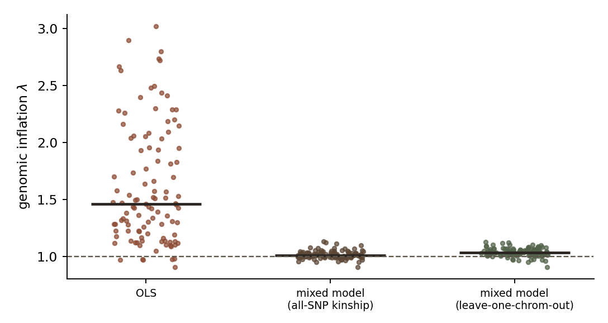
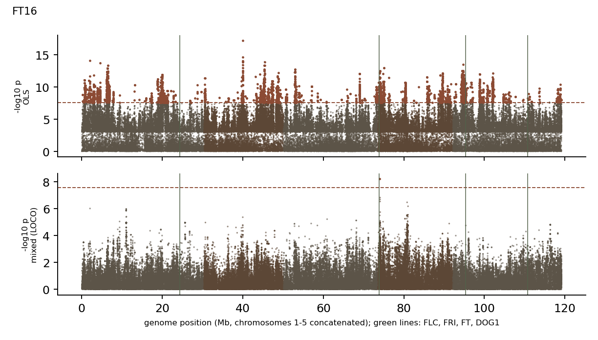

```{r setup}
suppressPackageStartupMessages({library(jsonlite); library(knitr)})
s <- fromJSON("../results/summary.json", simplifyVector = TRUE)
per <- read.csv("../results/per_phenotype.csv")
pairs <- read.csv("../results/candidate_pairs_empirical_p.csv")
f2 <- function(x) formatC(x, format = "f", digits = 2)
```

# Question

@atwell2010 ran genome-wide association studies (GWAS) on 107 phenotypes in 199 *Arabidopsis thaliana* inbred lines. They report that a simple test (Wilcoxon) is badly confounded by population structure, that the EMMA mixed model removes the excess of association for flowering-related traits, and also that EMMA's p-values "are not always well estimated and should be interpreted with caution". This report re-asks three narrow questions with a different implementation and a much denser SNP set:

1. Does the pattern replicate: strong inflation without correction, near-null calibration with a mixed model?
2. Does a leave-one-chromosome-out (LOCO) kinship, which avoids using a SNP's own region to model relatedness [@yang2014], change calibration or hits compared with an all-SNP kinship?
3. Do four well-known loci, chosen in advance, localise with the denser SNPs: *FLC*, *FRI* and *FT* for flowering traits, and *DOG1* for seed dormancy?

This is not an attempt to "beat" the paper, which already used a mixed model; it is a check on calibration and localisation with different data and software.

# Data

**Phenotypes.** AraPheno study 1 (the Atwell et al. phenotypes), `r s$n_phenotypes` phenotypes with `r s$n_min` to `r s$n_max` accessions each (median `r s$n_median`) after matching to genotypes. Replicate rows were averaged per accession, and each phenotype was rank-based inverse-normal transformed so that a parametric test is comparable with the paper's rank-based Wilcoxon test.

**Genotypes.** The 1001 Genomes imputed binary SNP matrix [@alonso2016]: 10,709,949 SNPs for 1,135 accessions. **Only 137 of the 199 lines in the original paper are in this release**, so these analyses have less power than the original. SNPs with minor-allele frequency below 5% among those 137 accessions were dropped, leaving 1,826,193 SNPs, about 8 times the 216,130 SNPs in the original study. I found no licence statement for the genotype matrix, so the repository contains download scripts, not data.

# Methods

All code is in `src/`; the statistical core (`src/lmm.py`) has tests (`tests/`) that check it against `scipy`'s OLS and against a brute-force generalised-least-squares computation.

- **OLS:** simple linear regression of the transformed phenotype on each SNP, no correction.
- **Mixed model (all-SNP kinship), EMMAX-style [@kang2010]:** $y = \mu + x\beta + g + e$ with $g \sim N(0, \sigma_g^2 K)$. $K$ is a realised relationship matrix from every 20th SNP (about 91,000 SNPs). The variance ratio $\delta = \sigma_g^2/\sigma_e^2$ is estimated once per phenotype by REML under the null and then fixed for all SNPs (the "P3D" approximation), after which each SNP needs a closed-form weighted regression.
- **Mixed model with LOCO kinship:** the same, but each chromosome is scanned with a kinship computed from SNPs on the other four chromosomes.
- **Significance:** Bonferroni, $0.05/1{,}826{,}193 = 2.7\times10^{-8}$. This is conservative because nearby SNPs are in strong linkage disequilibrium (LD).
- **Calibration:** genomic inflation factor $\lambda$ (median $\chi^2$ over 0.455) per phenotype and method.
- **Candidate loci, fixed before looking at results:** for each pre-specified trait--gene pair (12 flowering traits against *FLC*, *FRI*, *FT*; 2 dormancy traits against *DOG1*; `r s$n_candidate_pairs` pairs) I take the smallest p-value within the gene plus or minus 50 kb. Because that window holds about a thousand SNPs, a small minimum is unremarkable, so each is compared with 2,000 random windows of the same width: the **window empirical p** is the share of random windows with an equal or smaller minimum.

**Software.** Python 3.12, NumPy, SciPy, h5py; a fixed random seed for the null windows.

# Results

## Calibration: the paper's qualitative finding replicates

```{r lambda, fig.cap="Genomic inflation factor for each of the 107 phenotypes under three methods. Bars: medians. Dashed line: $\\lambda = 1$ (well calibrated).", out.width="75%"}

```

Without correction, `r round(100 * s$ols$"frac_lambda_gt_1.2")`% of phenotypes have $\lambda > 1.2$ (median `r f2(s$ols$lambda_median)`, interquartile range `r f2(s$ols$lambda_q1)` to `r f2(s$ols$lambda_q3)`, maximum `r f2(s$ols$lambda_max)`). With a mixed model the inflation is gone: median `r f2(s$emmax$lambda_median)` with the all-SNP kinship and `r f2(s$loco$lambda_median)` with LOCO kinship, and no phenotype exceeds $\lambda = `r f2(max(s$emmax$lambda_max, s$loco$lambda_max))`$ (Figure 1). This matches what @atwell2010 describe for flowering-related traits, here across all phenotypes and with a different implementation.

## What this does to the number of "hits"

| Method | Phenotypes with $\geq 1$ hit | Hit SNPs | Distinct 200 kb regions |
|---|---|---|---|
| OLS | `r s$ols$phenotypes_with_hit` | `r format(s$ols$total_hit_snps, big.mark=",")` | `r format(s$ols$total_loci_200kb, big.mark=",")` |
| Mixed model, all-SNP kinship | `r s$emmax$phenotypes_with_hit` | `r format(s$emmax$total_hit_snps, big.mark=",")` | `r s$emmax$total_loci_200kb` |
| Mixed model, LOCO kinship | `r s$loco$phenotypes_with_hit` | `r format(s$loco$total_hit_snps, big.mark=",")` | `r s$loco$total_loci_200kb` |

: Bonferroni-significant SNPs ($p < 2.7\times10^{-8}$) across the 107 phenotypes. SNP counts overstate independent signals because neighbouring SNPs are in LD; the last column is a rough count of independent regions.

`r s$ols_hit_but_no_lmm_hit` phenotypes have at least one OLS hit and no LOCO mixed-model hit; only `r s$lmm_hit_but_no_ols_hit` has the reverse. Flowering time shows it clearly: for FT16, OLS gives $\lambda = 3.0$ and 10,737 significant SNPs spread across all five chromosomes, while the LOCO mixed model gives one (Figure 2).

```{r manhattan, fig.cap="FT16 (n = 134), unadjusted (top) and mixed model with LOCO kinship (bottom). Dashed line: Bonferroni threshold. Green lines: FLC, FRI, FT, DOG1.", out.width="100%"}

```

The single mixed-model hit for FT16 lies at chromosome 4, position 435,252. It looks adjacent to *FRI* on the concatenated axis, but *FRI* ends at 271,503, so the hit is about 164 kb away and outside the pre-specified window. I do not count it as localising on *FRI*.

Phenotypes with the most mixed-model hits are not flowering traits and have small samples (for example YEL, n = 64, `r format(per$hits_loco[trimws(per$phenotype) == "YEL"], big.mark=",")` LOCO hit SNPs). I did not investigate them; many such SNPs are likely to be in LD with one or a few lead variants.

## All-SNP versus leave-one-chromosome-out kinship

The two mixed models give almost the same hits (`r format(s$emmax$total_hit_snps, big.mark=",")` against `r format(s$loco$total_hit_snps, big.mark=",")` SNPs, `r s$emmax$total_loci_200kb` against `r s$loco$total_loci_200kb` regions). Calibration differs slightly: LOCO has the higher median $\lambda$ (`r f2(s$loco$lambda_median)` against `r f2(s$emmax$lambda_median)`). A paired Wilcoxon test makes that difference highly detectable ($p = `r signif(s$wilcoxon_emmax_vs_loco_lambda_p, 2)`$) but it is small in size. It is consistent with the all-SNP kinship slightly deflating test statistics because it includes SNPs near the one being tested, which LOCO is designed to avoid [@yang2014]; I did not test that mechanism directly. For these data the choice does not change the conclusions.

## Do the known loci localise?

```{r cand}
sig <- pairs[pairs$loco < 0.05, ]
sig <- sig[order(sig$loco), ]
names(sig) <- c("Trait", "Locus", "Mixed (all-SNP)", "Mixed (LOCO)", "OLS")
kable(sig[, c("Trait", "Locus", "OLS", "Mixed (all-SNP)", "Mixed (LOCO)")], row.names = FALSE, digits = 3,
      caption = "Pre-specified trait-locus pairs with window empirical p < 0.05 under the LOCO mixed model.")
```

Of the `r s$n_candidate_pairs` pre-specified pairs, `r s$pairs_empirical_p_lt_0.05$loco` have a window empirical $p < 0.05$ under the LOCO mixed model, against about `r s$pairs_expected_by_chance` expected by chance; under OLS only `r s$pairs_empirical_p_lt_0.05$ols` do. Four of the eight are flowering traits at *FLC* (FT10, FT16, LN22, SDV), three are at *FT* (0W GH FT, FT Field, LN16) and one is at *FRI* (LN22, which also appears at *FLC*); FT22 at *FLC* just misses under LOCO (0.054); none involves *DOG1* (seed-dormancy windows: empirical $p$ from `r f2(min(pairs$loco[pairs$gene == "DOG1"]))` to `r f2(max(pairs$loco[pairs$gene == "DOG1"]))`), and the *FLC* expression phenotype does not localise on *FLC* or *FRI* (empirical $p$ `r f2(pairs$loco[pairs$phenotype == "FLC" & pairs$gene == "FLC"])` and `r f2(pairs$loco[pairs$phenotype == "FLC" & pairs$gene == "FRI"])`).

Two cautions apply. First, the flowering phenotypes are strongly correlated with each other [@atwell2010], so these eight pairs are not eight independent confirmations. Second, after a Bonferroni correction over 38 pairs (threshold 0.0013), only FT10--*FLC* under the all-SNP kinship ($p = `r formatC(pairs$emmax[pairs$phenotype == "FT10" & pairs$gene == "FLC"], format = "f", digits = 3)`$, borderline) would survive; under LOCO it is `r formatC(pairs$loco[pairs$phenotype == "FT10" & pairs$gene == "FLC"], format = "f", digits = 3)`, which does not. The evidence is suggestive for *FLC* and *FT* in flowering traits, and absent for *DOG1* at this sample size.

## Heritability estimates

The REML estimates of $\sigma_g^2 / (\sigma_g^2 + \sigma_e^2)$ have a median of `r f2(s$h2_median)`, but `r round(100 * s$"h2_frac_near_one_gt_0.99")`% of phenotypes sit at the upper boundary ($>0.99$) and `r round(100 * s$"h2_frac_near_zero_lt_0.01")`% at the lower ($<0.01$). With 51 to 135 lines these estimates are imprecise (my own simulation test gave a standard deviation of about 0.3 at $n = 200$), so I treat them only as an input to the mixed model, not as findings.

# Discussion and limitations

**What this shows.** On 1.83 million SNPs and 137 of the original lines, an independent mixed-model implementation reproduces the paper's calibration result across all 107 phenotypes, and a leave-one-chromosome-out kinship changes little. Mixed models also recover more flowering-gene signals than uncorrected tests (8 against 2 pairs below 0.05), though the evidence is modest.

**What it does not show.** It does not improve on the paper's conclusions, and I did not compare my hit lists with the paper's supplementary tables, so I cannot say whether the same loci are found. The data overlap the original study (the same phenotypes and 137 of the same lines), so this is a robustness check, not an independent replication.

- **Power.** Only 137 of 199 lines are in the genotype release; sample sizes are 51 to 135. A non-significant result, such as for *DOG1*, is not evidence of no effect.
- **Method choices.** Phenotypes were rank-inverse-normal transformed; the paper's choices may differ. The P3D approximation fixes the variance ratio per phenotype. Kinship uses about 91,000 thinned SNPs. Bonferroni correction over all SNPs is conservative under strong LD.
- **Genotypes.** The matrix is imputed, and imputation error is not modelled. SNPs were filtered at 5% minor-allele frequency among the 137 lines.
- **Candidate-gene test.** Pre-specified, but the pairs are correlated and the window (gene plus or minus 50 kb) differs from the paper's 20 kb windows around its top SNPs.
- **Data.** No licence statement was found for the 1001 Genomes genotype matrix, so it is not redistributed here; `src/00_download.sh` fetches it.

# Provenance and reproducibility

All data are public (AraPheno, the 1001 Genomes, Ensembl Plants for gene coordinates). Run `src/00_download.sh`, then `src/01_prepare.py`, `src/02_scan.py` (about 40 minutes on a laptop) and `src/03_summarise.py`, then render this report. Tests: `python -m pytest`. The code and report were written and run with the assistance of Claude Code (Anthropic); I am responsible for checking and understanding the results. No part derives from university coursework or assessed material.

# References
